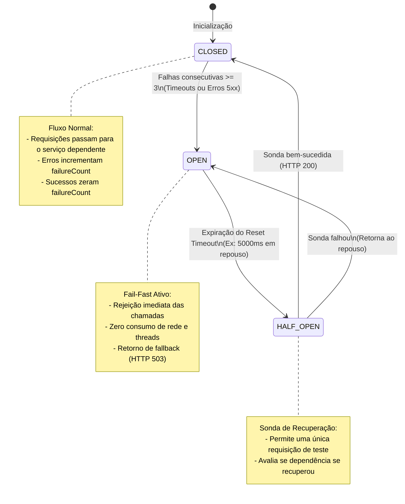

# Gestão de Falhas e Escalabilidade Seletiva em Microserviços

Este documento aprofunda os padrões arquiteturais essenciais para garantir **alta disponibilidade**, **tolerância a falhas** e **elasticidade computacional** em sistemas distribuídos de microserviços.

---

## 1. Estratégias para Gerenciamento e Mitigação de Falhas

Em uma arquitetura distribuída, falhas de rede, lentidão de dependências e indisponibilidade temporária de nós não são exceções — são certezas operacionais. Sem mecanismos de proteção, uma falha pontual em um serviço downstream propaga-se rapidamente por toda a cadeia de chamadas, resultando no colapso do sistema (*Cascading Failure*).



### 1.1. O Padrão Circuit Breaker (Disjuntor de Circuito)
Implementado nativamente no nosso [auth-client.js](file:///c:/Users/Diego/Documents/ProjetosAntigravityBruno/services/catalog-service/src/auth-client.js):

- **Estado CLOSED (Fechado)**: O tráfego flui normalmente. O cliente HTTP monitora a taxa de erros e timeouts. Se o número de falhas consecutivas ultrapassar o limiar (`failureThreshold = 3`), o disjuntor desarma e entra no estado `OPEN`.
- **Estado OPEN (Aberto - Fail-Fast)**: Em vez de desperdiçar conexões de rede e manter threads ocupadas esperando por um serviço que sabidamente está inoperante, qualquer nova requisição é rejeitada **instantaneamente** (latência próxima de 0ms), retornando resposta de *fallback* e código `503 Service Unavailable`. Isso protege tanto o chamador contra esgotamento de recursos (*Thread Starvation*) quanto o serviço doente, permitindo que ele se recupere sem receber uma avalanche de requisições.
- **Estado HALF_OPEN (Meio-Aberto)**: Após um período de repouso configurável (`resetTimeoutMs = 5000ms`), o disjuntor autoriza a passagem de uma requisição de teste ("sonda"). Se ela for bem-sucedida, o circuito conclui que o serviço upstream recuperou sua saúde e retorna para `CLOSED`. Caso a sonda falhe, o circuito volta imediatamente para `OPEN` por mais um ciclo de espera.

---

### 1.2. Timeouts Determinísticos e Prevenção de Thread Exhaustion
- Toda chamada inter-serviços deve possuir um **tempo limite de espera rígido** (no projeto: `1500ms` via `AbortController`).
- Sem timeouts explícitos, clientes HTTP utilizam valores padrão do sistema operacional (frequentemente de 60 a 120 segundos). Se 50 clientes simultâneos fizerem requisições para um serviço que trava, todas as conexões do pool de threads esgotam-se em poucos segundos, derrubando o microserviço chamador.

---

### 1.3. Retries com Exponential Backoff e Jitter
Ao identificar falhas transitórias de rede, retentar imediatamente a requisição sem intervalo de espera pode provocar o **Efeito Manada** (*Thundering Herd Problem*).
A solução adotada no nosso cliente HTTP implementa:
1. **Backoff Exponencial**: Intervalo crescente entre tentativas:
   $$\text{Delay} = 2^{\text{tentativa}} \times 150\text{ms}$$
2. **Full Jitter (Ruído Aleatório)**: Adiciona uma variação aleatória de 0 a 50ms ao tempo calculado, garantindo que centenas de instâncias não retentem a chamada exatamente no mesmo milissegundo:
   $$\text{DelayTotal} = (2^{\text{tentativa}} \times 150) + \text{random}(0, 50)\text{ms}$$

---

### 1.4. Dead Letter Queue (DLQ) e Poison Pills em Mensageria
Na comunicação assíncrona, se um consumidor receber uma mensagem com formato corrompido ou dados inconsistentes (*Poison Pill*), a rejeição ingênua com recolocação na fila (`requeue=true`) cria um **loop infinito de consumo e quebra**, saturando o consumo de CPU e bloqueando outras mensagens válidas.

**Arquitetura implementada no RabbitMQ:**
1. A fila principal `notification.events` é configurada com o argumento `x-dead-letter-exchange: ecommerce.dlx`.
2. Quando o consumidor captura uma exceção irrecuperável, executa `channel.nack(msg, false, false)` (com `requeue=false`).
3. O broker descarta a mensagem da fila primária e a roteia imediatamente para a fila morta `ecommerce.events.dlq`.
4. Equipes de engenharia e ferramentas de monitoramento podem auditar as mensagens da DLQ, corrigir bugs e reinjetá-las sem perda de dados históricos.

---

### 1.5. Bulkhead Pattern (Isolamento de Compartimentos)
Inspirado nas anteparas dos cascos de navios, o padrão Bulkhead divide os recursos da aplicação (pools de conexão, limites de CPU/memória e limites de requisições simultâneas) em compartimentos estanques.
No nosso arquivo [docker-compose.yml](file:///c:/Users/Diego/Documents/ProjetosAntigravityBruno/docker-compose.yml), definimos cotas estritas de recursos:
```yaml
deploy:
  resources:
    limits:
      cpus: '0.75'
      memory: 384M
    reservations:
      cpus: '0.15'
      memory: 96M
```
Isso impede que um vazamento de memória ou pico de processamento no microserviço de Catálogo afete o Microserviço de Autenticação ou o Gateway no mesmo nó físico.

---

### 1.6. Healthchecks, Liveness e Readiness Probes
Distinção fundamental implementada tanto no Docker quanto no Kubernetes:
- **Readiness Probe (`/health`)**: Verifica se o serviço inicializou suas conexões com bancos e brokers e está pronto para receber tráfego de clientes. Caso retorne status diferente de 200, o orquestrador apenas remove o pod do balanceador de carga, sem reiniciá-lo.
- **Liveness Probe (`/health`)**: Verifica se a aplicação travou em deadlock ou thread freeze. Se falhar continuamente, o orquestrador mata o container e instancia uma nova réplica limpa (*Self-Healing*).

---

## 2. Estratégias para Escalabilidade Seletiva

Em uma aplicação monolítica, para lidar com um pico de acessos à vitrine de produtos, é necessário escalar toda a aplicação (incluindo relatórios, faturamento e autenticação), gerando alto custo computacional.

Na arquitetura de microserviços, o tráfego é profundamente assimétrico:
- **Catalog Service**: Tráfego de leitura intensivo (razão típica de 100 leituras para 1 gravação). Sofre grandes oscilações durante promoções ou Black Friday.
- **Auth Service**: Tráfego moderado (usuários fazem login poucas vezes e reutilizam o token JWT por 1 hora).
- **Notification Service**: Tráfego em background desacoplado.

```mermaid
graph TD
    subgraph WorkloadDistribution["Assimetria de Carga Típica"]
        GW["API Gateway<br/>10.000 req/s"] -->|8.500 req/s (85%)| CatCluster["Catalog Service Cluster<br/>(Escala para 10 Réplicas)"]
        GW -->|1.200 req/s (12%)| AuthCluster["Auth Service Cluster<br/>(2 Réplicas Estáveis)"]
        GW -->|300 req/s (3%)| NotifCluster["Notification Service<br/>(1 Réplica Assíncrona)"]
    end
```

---

### 2.1. Escalabilidade Seletiva no Docker Compose
O Docker Compose permite escalar horizontalmente qualquer serviço individual sem reiniciar os demais:

```bash
# Escalar seletivamente apenas o catalog-service para 3 réplicas:
docker compose up -d --scale catalog-service=3
```

**Como funciona o balanceamento de carga no Docker:**
1. O Docker Engine cria múltiplos containers: `ecommerce-catalog-service-1`, `ecommerce-catalog-service-2`, `ecommerce-catalog-service-3`.
2. Todos os containers são registrados sob o mesmo alias de rede DNS interno (`catalog-service`).
3. Quando o `api-gateway` (Nginx) resolve o nome de host `http://catalog-service:4002`, o servidor DNS embutido do Docker retorna a lista de IPs de todas as réplicas ativas em formato **Round-Robin**.
4. Cada nova requisição é direcionada para uma réplica distinta, distribuindo a carga de CPU e memória uniformemente.

---

### 2.2. Escalabilidade Elástica no Kubernetes com HorizontalPodAutoscaler (HPA)
No Kubernetes, a escalabilidade seletiva pode ser automatizada com base em métricas em tempo real através do manifest [catalog-hpa.yaml](file:///c:/Users/Diego/Documents/ProjetosAntigravityBruno/k8s/05-catalog-hpa.yaml):

```yaml
apiVersion: autoscaling/v2
kind: HorizontalPodAutoscaler
metadata:
  name: catalog-service-hpa
  namespace: ecommerce
spec:
  scaleTargetRef:
    apiVersion: apps/v1
    kind: Deployment
    name: catalog-service
  minReplicas: 2
  maxReplicas: 10
  metrics:
  - type: Resource
    resource:
      name: cpu
      target:
        type: Utilization
        averageUtilization: 70
```

#### Regras de Otimização do HPA:
1. **Scale Up Rápido**: Caso a utilização média de CPU passe de 70%, o HPA dobra o número de réplicas em intervalos de 15 segundos (`periodSeconds: 15`), absorvendo picos repentinos sem lentidão percebida pelo usuário final.
2. **Scale Down Gradual (Anti-Flapping)**: Para evitar o fenômeno de oscilação constante (*flapping* — subir e descer réplicas repetidamente), o HPA aguarda uma janela de estabilização de 300 segundos (5 minutos) antes de reduzir instâncias ociosas.
3. **Escalonamento Baseado em Filas (KEDA / Custom Metrics)**: No caso do `notification-service`, a métrica ideal de escalabilidade não é CPU, mas a quantidade de mensagens acumuladas na fila do RabbitMQ. Com o KEDA (Kubernetes Event-driven Autoscaling), é possível configurar o autoscaler para adicionar réplicas do consumidor sempre que a fila ultrapassar, por exemplo, 500 mensagens não processadas.

---

### 2.3. Diretrizes de Statelessness para Microsserviços
Para que a escalabilidade seletiva funcione sem corromper o estado do sistema:
- **Nenhum microserviço deve armazenar estado de sessão em memória local do container**. Sessões e autorizações devem ser auto-contidas via JWT ou armazenadas em um cache distribuído compartilhado (Redis Cluster).
- **Idempotência em Consumidores**: Como a adição de múltiplas réplicas de consumidores na mesma fila pode gerar re-entregas em cenários de crash de nó, todo processamento de evento deve checar o ID único do evento antes de executar efeitos colaterais.
