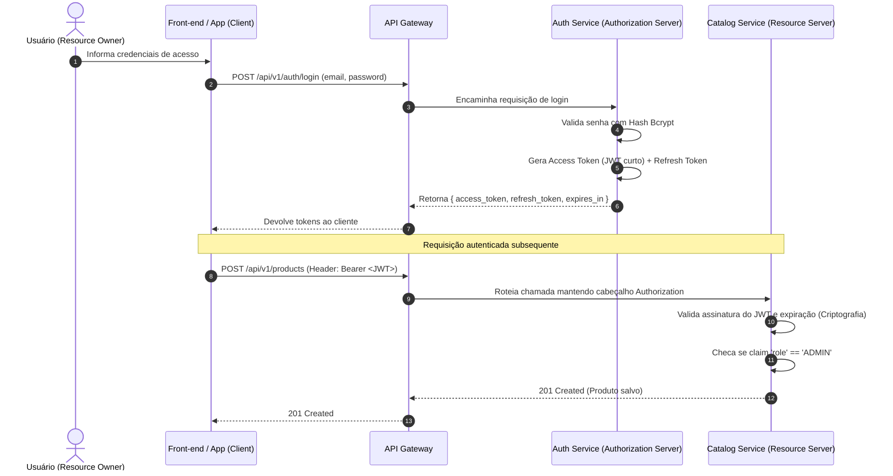

# Segurança em Microserviços: JWT, OAuth 2.0 e Chaves Assimétricas

A segurança em arquiteturas distribuídas exige que cada microserviço seja capaz de autenticar e autorizar requisições sem depender de sessões de estado em memória e sem transformar o servidor de autenticação em um gargalo central.

---

## 1. Fundamentos do OAuth 2.0 em Microserviços

O protocolo OAuth 2.0 estabelece quatro papéis bem definidos:



### 1.1. Papéis Arquiteturais:
1. **Resource Owner**: O usuário final detentor dos dados.
2. **Client**: A aplicação web ou móvel que solicita acesso em nome do usuário.
3. **Authorization Server (`auth-service`)**: Emite tokens JWT após validar credenciais e gerencia o ciclo de vida das chaves criptográficas.
4. **Resource Server (`catalog-service`)**: Protege os recursos de negócio e valida os tokens recebidos para conceder ou negar acesso.

### 1.2. Principais Fluxos OAuth 2.0 Aplicáveis:
- **Authorization Code com PKCE (Proof Key for Code Exchange)**: Padrão ouro para Single Page Applications (SPAs) e Mobile Apps. Evita a exposição de segredos no código cliente e previne ataques de interceptação de código de autorização.
- **Client Credentials Grant**: Utilizado para comunicação **máquina-para-máquina (M2M)** direta entre microserviços em background, onde o serviço chamador autentica-se com seu próprio `client_id` e `client_secret`.

---

## 2. Anatomia de um JSON Web Token (JWT)

O JWT é uma estrutura serializada compacta no formato `Header.Payload.Signature`, codificada em Base64Url:

### 2.1. Header (Cabeçalho)
Declara o algoritmo de hash e o tipo de token:
```json
{
  "alg": "RS256",
  "typ": "JWT",
  "kid": "auth-key-2026-09"
}
```
- `alg`: Algoritmo criptográfico utilizado (ex: `RS256` para chaves assimétricas RSA ou `HS256` para chave simétrica HMAC).
- `kid` (*Key ID*): Identificador da chave que assinou o token, permitindo rotação suave de chaves.

### 2.2. Payload (Claims de Autorização)
Transporta as declarações sobre o usuário e a sessão:
```json
{
  "sub": "user-001",
  "name": "Administrador Antigravity",
  "email": "admin@empresa.com",
  "role": "ADMIN",
  "iss": "auth-service",
  "aud": "ecommerce-microservices",
  "iat": 1789142400,
  "exp": 1789146000
}
```
- **Claims Registradas (RFC 7519)**:
  - `sub` (*Subject*): Identificador único do usuário no banco.
  - `iss` (*Issuer*): Quem emitiu o token (`auth-service`).
  - `aud` (*Audience*): Ecossistema de destino pretendido.
  - `exp` (*Expiration Time*): Data/hora Unix após a qual o token torna-se inválido.
  - `iat` (*Issued At*): Data/hora Unix da emissão.
- **Claims Personalizadas**:
  - `role`: Perfil de acesso para controle RBAC (*Role-Based Access Control*).

### 2.3. Signature (Assinatura Criptográfica)
Garante a integridade do token. Caso qualquer caractere do Header ou do Payload seja adulterado por um interceptador, a validação matemática da assinatura falhará.

---

## 3. Chaves Simétricas (HS256) vs Assimétricas (RS256 / Ed25519)

Em arquiteturas de microserviços em larga escala, a escolha do algoritmo criptográfico dita o acoplamento e a segurança da solução:

| Característica | Assinatura Simétrica (HS256) | Assinatura Assimétrica (RS256 / EdDSA) |
| :--- | :--- | :--- |
| **Chaves Envolvidas** | Uma única chave secreta compartilhada (*Shared Secret*). | Um par de chaves: **Privada** (assina) e **Pública** (valida). |
| **Distribuição da Chave** | **Crítica**: Todos os microserviços precisam conhecer o segredo. | **Segura**: Apenas o `auth-service` conhece a Chave Privada. |
| **Risco de Vazamento** | Se o container do Catálogo for invadido, o atacante obtém a chave e pode forjar tokens como Administrador para qualquer outro serviço. | Mesmo que o Catálogo seja comprometido, ele possui apenas a Chave Pública e **não consegue forjar novos tokens**. |
| **Validação Descentralizada** | Possível, mas arriscada pelo compartilhamento da chave. | **Ideal**: Todos os serviços validam tokens localmente de forma offline e ultrarrápida. |
| **Padrão de Rotação** | Complexo (exige atualização coordenada de variáveis em todos os nós). | **Transparente**: Via endpoint padronizado **JWKS** (`/.well-known/jwks.json`). |

### Arquitetura com JWKS (JSON Web Key Set):
1. O `auth-service` expõe um endpoint público `/api/v1/auth/jwks.json` contendo as chaves públicas em formato padronizado RFC 7517.
2. Os microserviços de recursos (como `catalog-service`) realizam cache da chave pública por 24 horas.
3. Ao receber uma requisição, o microserviço valida a assinatura e expiração do JWT em **0.2 milissegundos**, sem fazer nenhuma chamada de rede ao `auth-service`.
4. **Benefício**: Se o `auth-service` sofrer lentidão ou indisponibilidade total, os clientes autenticados continuam navegando e operando o Catálogo normalmente!

---

## 4. Gerenciamento do Ciclo de Vida e Revogação de Tokens

### 4.1. Tokens de Curta Duração + Rotação de Refresh Tokens
- **Access Token**: Tempo de vida curto (ex: **15 a 60 minutos**). Mitiga o impacto em caso de vazamento acidental.
- **Refresh Token**: Tempo de vida longo (ex: **7 a 30 dias**), armazenado com flag `HttpOnly`, `Secure` e `SameSite=Strict`.
- **Refresh Token Rotation**: A cada uso do refresh token para obter um novo access token, o refresh token antigo é imediatamente invalidado e substituído por um novo. Se o token antigo for reutilizado (tentativa de replay), o sistema detecta a fraude e revoga toda a árvore de sessões daquele usuário.

### 4.2. Estratégia de Revogação Imediata (Denylist / Blacklist)
Por ser *stateless*, um JWT é válido até sua data de expiração (`exp`). Caso um usuário faça logout ou tenha sua conta desativada por segurança:
1. O `auth-service` armazena o `jti` (JWT ID único) ou `userId + iat` em um cluster **Redis** com expiração igual ao tempo restante do token (*TTL = exp - now*).
2. O API Gateway ou o middleware do microserviço consulta o Redis em memória antes de autorizar a requisição.
3. O volume de tokens na blacklist é extremamente reduzido (apenas tokens revogados antes do tempo de vida natural), garantindo latência inferior a 1ms na checagem.

---

## 5. Checklist de Boas Práticas de Segurança em Microserviços

- [x] **Não expor portas internas de microserviços**: Manter os serviços em rede privada (`backend_net`), com apenas o API Gateway na porta externa pública (`8080`).
- [x] **Validação do Algoritmo Criptográfico**: Bloquear estritamente ataques de substituição de algoritmo (`alg: "none"`).
- [x] **Tratamento de Headers Sensíveis**: Sanitizar logs para nunca registrar tokens JWT inteiros ou senhas em texto puro.
- [x] **Defesa em Profundidade**: Mesmo com validação no Gateway, microserviços internos devem validar tokens em chamadas sensíveis (*Zero Trust Architecture*).
