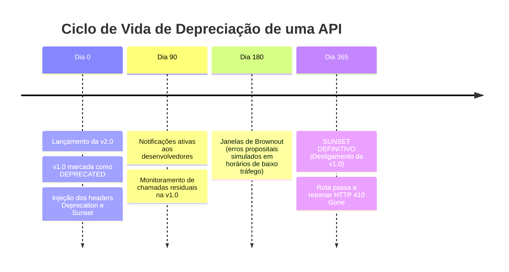

# Boas Práticas de Versionamento de APIs em Microserviços

O versionamento de APIs em ecossistemas de microserviços é crucial para garantir a evolução contínua das funcionalidades sem quebrar contratos estabelecidos com clientes externos (Web, Mobile, Parceiros) ou outros microserviços internos.

---

## 1. Abordagens de Versionamento: Comparativo Técnico

Existem três estratégias principais para versionar contratos de API REST:

| Critério | 1. URI Path Versioning (Recomendado) | 2. Header / Content Negotiation | 3. Query Parameter Versioning |
| :--- | :--- | :--- | :--- |
| **Exemplo de Requisição** | `GET /api/v1/products`<br/>`GET /api/v2/products` | `GET /api/products`<br/>`Accept: application/vnd.empresa.v2+json` | `GET /api/products?version=2` |
| **Visibilidade e Clareza** | **Alta**: Imediatamente visível na URL e nos logs de acesso. | **Média**: Oculto nos cabeçalhos HTTP. | **Alta**: Visível na URL. |
| **Roteamento no API Gateway** | **Simples**: Roteamento por regex/prefixo no Nginx (`location /api/v1/`). | **Complexo**: Requer parsing de cabeçalhos no proxy reverso. | **Médio**: Requer rewrite de URL com base em query string. |
| **Compatibilidade com Cache** | **Excelente**: CDNs e proxies usam a URI completa como chave de cache natural. | **Crítica**: Exige configuração rigorosa de cabeçalho `Vary: Accept`. | **Boa**: Suportado por CDNs com query string caching. |
| **Facilidade de Exploração** | **Excelente**: Fácil de testar em navegadores, Swagger e cURL. | **Difícil**: Requer ferramentas capazes de customizar headers HTTP. | **Boa**: Testável diretamente pelo browser. |
| **Aderência aos Princípios REST** | Quebra o princípio de que uma URI identifica exclusivamente um recurso. | Segue os princípios puros do HATEOAS e negociação de conteúdo. | Considerado anti-pattern em designs RESTful rigorosos. |

> [!TIP]
> **Padrão Adotado no Nosso Projeto**: Utilizamos **URI Path Versioning** (`/api/v1/...`). Na prática da indústria (adotada por GitHub, Stripe, AWS e Google), a simplicidade operacional, o roteamento direto no API Gateway e a facilidade de depuração em logs superam o purismo teórico do REST.

---

## 2. Regras de Compatibilidade Retroativa (Backward Compatibility)

Para evitar versões de API desnecessárias, adota-se o princípio da **Evolução Não-Destrutiva**:

### Mudanças Permitidas sem Nova Versão (Não Quebram Contrato):
1. **Adição de Novos Campos**: Adicionar campos opcionais no payload de resposta JSON. Clientes bem projetados seguem o *Tolerant Reader Pattern* e ignoram campos que não conhecem.
2. **Adição de Novos Endpoints**: Novos recursos podem ser inseridos na mesma versão (`POST /api/v1/products/:id/reviews`).
3. **Novos Parâmetros Opcionais de Query**: Adicionar opções de filtro (`?sort=price_desc`) mantendo valores padrão para requisições antigas.

### Mudanças que Exigem Nova Versão Maior (`/api/v2/`):
1. **Remoção ou Renomeação de Campos Existentes**: Alterar `product.price` para `product.amount_in_cents`.
2. **Alteração do Tipo de Dado**: Modificar um campo de `string` para `object` ou `array`.
3. **Tornar um Campo Opcional em Obrigatório** no payload de requisições `POST` ou `PUT`.
4. **Mudança Semântica de Código de Resposta HTTP**: Mudar de `200 OK` para `202 Accepted` de forma inesperada.

---

## 3. Política de Depreciação e Sunset (RFC 8594)

Quando uma versão antiga (ex: `/api/v1/`) precisa ser descontinuada em favor da `/api/v2/`, deve-se implementar uma política previsível de ciclo de vida com base nos padrões do IETF (RFC 8594):



### Cabeçalhos HTTP Padronizados na Resposta da API:
```http
HTTP/1.1 200 OK
Content-Type: application/json
Deprecation: @1757548800
Sunset: Wed, 11 Nov 2026 00:00:00 GMT
Link: <https://developer.empresa.com/docs/migracao-v1-para-v2>; rel="deprecation"; type="text/html"
```

1. **`Deprecation`**: Indica que a API foi descontinuada e a data Unix de marcação.
2. **`Sunset`**: Data e hora exatas em que o endpoint será desligado permanentemente e deixará de responder.
3. **`Link`**: URL contendo o guia detalhado de migração para a nova versão.
4. **Após a Data Sunset**: O API Gateway deve interceptar chamadas para `/api/v1/` e retornar status `410 Gone`, informando explicitamente que o recurso foi desativado.

---

## 4. Governança de Contratos com OpenAPI / Swagger

Em ecossistemas orquestrados, equipes trabalham de forma independente. Para evitar divergências:
1. **Design-First ou Code-First com OpenAPI 3.0**: Os contratos JSON/YAML devem ser versionados no repositório de código.
2. **Contract Testing (Pact / Dredd)**: Testes automatizados executados na pipeline de CI/CD validam se as alterações de código respeitam rigorosamente o contrato OpenAPI da versão ativa antes da criação da imagem Docker.
