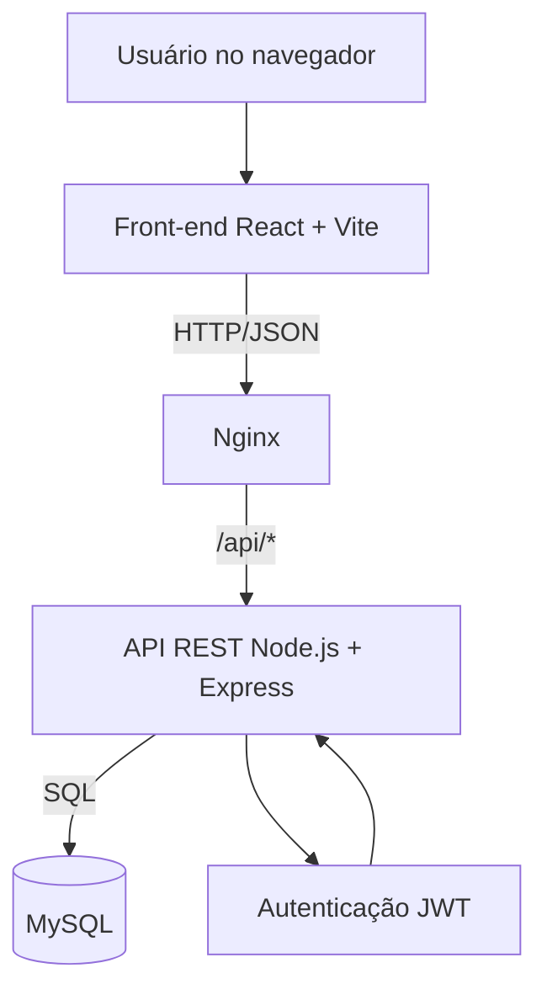

# Arquitetura — Sistema Financeiro Pessoal

## Diagrama

## Componentes
- **Front-end:** React apresenta login/cadastro, dashboard e formulário de transações.
- **Nginx:** entrega os arquivos estáticos do front-end e encaminha `/api/*` para o back-end.
- **API REST:** Express implementa autenticação e operações de transações.
- **Banco de dados:** MySQL armazena usuários e transações com vínculo por usuário.
- **Docker Compose:** executa os três serviços e mantém os dados em volume persistente.

## Endpoints principais

| Método | Rota | Objetivo |
|---|---|---|
| GET | `/api/health` | Verificar API e conexão com banco |
| POST | `/api/auth/cadastro` | Cadastrar usuário |
| POST | `/api/auth/login` | Autenticar e receber JWT |
| GET | `/api/transacoes` | Listar transações do usuário autenticado |
| POST | `/api/transacoes` | Criar transação |
| DELETE | `/api/transacoes/:id` | Excluir transação do usuário |

As rotas de transações exigem `Authorization: Bearer <token>`. Cada consulta é limitada ao usuário autenticado.
